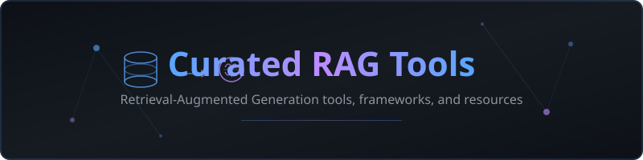

  

  
  
  
  

# Curated RAG Tools

A curated collection of tools, frameworks, databases, and services for building **Retrieval-Augmented Generation (RAG)** systems. RAG combines the power of large language models with external knowledge retrieval, enabling AI applications that are grounded in real, up-to-date information rather than relying solely on training data.

Whether you are building a chatbot that references your company docs, a research assistant that cites sources, or a code-aware AI tool, this list covers every layer of the RAG stack -- from document ingestion and chunking, through vector storage and retrieval, to evaluation and production deployment.

---

## Contents

- [Featured](#featured)
- [RAG Frameworks](#rag-frameworks)
- [Vector Databases](#vector-databases)
- [Embedding Models](#embedding-models)
- [Document Loaders & Parsers](#document-loaders--parsers)
- [Chunking & Preprocessing](#chunking--preprocessing)
- [Retrieval & Reranking](#retrieval--reranking)
- [Evaluation](#evaluation)
- [RAG-as-a-Service](#rag-as-a-service)
- [Recently Added](#recently-added)
- [Related Lists](#related-lists)
- [Contributing](#contributing)

---

## Featured

> **[Ssemble AI Clipping](https://www.ssemble.com)** -- AI-powered video clipping tool that turns long videos into viral short clips. Available as an [MCP server on npm](https://www.npmjs.com/package/@ssemble/mcp-server) for seamless integration with AI workflows. Automatically identifies the most engaging moments, adds captions, and exports in vertical format for TikTok, YouTube Shorts, and Instagram Reels.

---

## RAG Frameworks

End-to-end frameworks and libraries for building RAG pipelines.

| Tool | Description | Links |
|------|-------------|-------|
| **LangChain** | Comprehensive framework for developing LLM-powered applications with built-in RAG chains, document loaders, and retriever abstractions. | [GitHub](https://github.com/langchain-ai/langchain) &#124; [Docs](https://python.langchain.com/) |
| **LlamaIndex** | Data framework for connecting custom data sources to LLMs. Provides advanced indexing, retrieval, and query engine capabilities purpose-built for RAG. | [GitHub](https://github.com/run-llama/llama_index) &#124; [Docs](https://docs.llamaindex.ai/) |
| **Haystack** | Open-source framework by deepset for building production-ready NLP and RAG pipelines with a modular, pipeline-based architecture. | [GitHub](https://github.com/deepset-ai/haystack) &#124; [Docs](https://docs.haystack.deepset.ai/) |
| **RAGFlow** | Open-source RAG engine with deep document understanding, template-based chunking, and grounded citations with reduced hallucinations. | [GitHub](https://github.com/infiniflow/ragflow) &#124; [Website](https://ragflow.io/) |
| **Canopy** | Open-source RAG framework by Pinecone built on top of their vector database, offering a production-ready chat application stack. | [GitHub](https://github.com/pinecone-io/canopy) |
| **Verba** | Golden RAGtriever -- open-source modular RAG application by Weaviate that provides an end-to-end interface for exploring datasets. | [GitHub](https://github.com/weaviate/Verba) |
| **Cognita** | Open-source modular RAG framework by TrueFoundry for organizing code into components -- data sources, embedders, parsers, and query engines. | [GitHub](https://github.com/truefoundry/cognita) |
| **PrivateGPT** | Production-ready AI project for privately interacting with documents using LLMs. Supports 100% offline, private RAG deployments. | [GitHub](https://github.com/zylon-ai/private-gpt) &#124; [Docs](https://docs.privategpt.dev/) |
| **Quivr** | Open-source personal AI assistant with RAG capabilities. Supports multiple file formats, conversation memory, and various LLM backends. | [GitHub](https://github.com/QuivrHQ/quivr) &#124; [Website](https://www.quivr.com/) |
| **R2R (RAG to Riches)** | Production-ready RAG engine by SciPhi with built-in auth, ingestion, search, and management APIs, designed for rapid deployment. | [GitHub](https://github.com/SciPhi-AI/R2R) &#124; [Docs](https://r2r-docs.sciphi.ai/) |
| **FastRAG** | Research framework by Intel Labs for efficient and optimized RAG pipelines, built on top of Haystack with focus on performance. | [GitHub](https://github.com/IntelLabs/fastRAG) |
| **Ragoon** | High-level library designed for dynamic RAG pipeline building with focus on simplicity and extensibility. | [GitHub](https://github.com/predictionguard/ragoon) |

## Vector Databases

Purpose-built databases for storing, indexing, and querying high-dimensional vector embeddings.

| Tool | Description | Links |
|------|-------------|-------|
| **Pinecone** | Fully managed vector database optimized for machine learning applications. Provides low-latency similarity search at scale with serverless and pod-based architectures. | [Website](https://www.pinecone.io/) &#124; [Docs](https://docs.pinecone.io/) |
| **Weaviate** | Open-source vector database that stores both objects and vectors. Supports hybrid search (vector + keyword), modules for vectorization, and GraphQL API. | [GitHub](https://github.com/weaviate/weaviate) &#124; [Docs](https://weaviate.io/developers/weaviate) |
| **Qdrant** | Open-source vector similarity search engine with an API service. Written in Rust for performance, supports filtering, payloads, and distributed deployments. | [GitHub](https://github.com/qdrant/qdrant) &#124; [Docs](https://qdrant.tech/documentation/) |
| **Milvus** | Open-source vector database built for scalable similarity search. Supports billions of vectors, GPU acceleration, and multiple index types. | [GitHub](https://github.com/milvus-io/milvus) &#124; [Docs](https://milvus.io/docs) |
| **Chroma** | Open-source embedding database designed for AI-native applications. Simple API, runs in-process or as a server, with built-in embedding functions. | [GitHub](https://github.com/chroma-core/chroma) &#124; [Docs](https://docs.trychroma.com/) |
| **pgvector** | Open-source PostgreSQL extension for vector similarity search. Enables vector operations alongside traditional SQL queries in existing Postgres deployments. | [GitHub](https://github.com/pgvector/pgvector) |
| **FAISS** | Library by Meta AI for efficient similarity search and clustering of dense vectors. Industry standard for ANN search with CPU and GPU support. | [GitHub](https://github.com/facebookresearch/faiss) &#124; [Docs](https://faiss.ai/) |
| **Vespa** | Open-source big data serving engine by Yahoo that supports vector search, text search, and structured data queries in a single platform. | [GitHub](https://github.com/vespa-engine/vespa) &#124; [Docs](https://docs.vespa.ai/) |
| **LanceDB** | Open-source serverless vector database built on Lance columnar format. Runs embedded with zero infra, supporting multimodal data and automatic versioning. | [GitHub](https://github.com/lancedb/lancedb) &#124; [Docs](https://lancedb.github.io/lancedb/) |
| **Turbopuffer** | Serverless vector database focused on low-latency, high-throughput search with transparent pricing and zero operational overhead. | [Website](https://turbopuffer.com/) &#124; [Docs](https://turbopuffer.com/docs) |
| **Marqo** | Open-source tensor search engine that combines embedding generation and vector search into a single API, simplifying the vector pipeline. | [GitHub](https://github.com/marqo-ai/marqo) &#124; [Docs](https://docs.marqo.ai/) |

## Embedding Models

Models and APIs for converting text, images, and other data into vector embeddings.

| Tool | Description | Links |
|------|-------------|-------|
| **OpenAI text-embedding-3** | State-of-the-art embedding models from OpenAI. The `text-embedding-3-large` model provides 3072 dimensions with native dimensionality reduction support. | [Docs](https://platform.openai.com/docs/guides/embeddings) |
| **Cohere Embed v3** | Multilingual embedding model supporting 100+ languages with built-in compression. Offers search, classification, and clustering optimized variants. | [Docs](https://docs.cohere.com/docs/cohere-embed) |
| **Voyage AI** | High-performance embedding models optimized for retrieval. Offers domain-specific models for code, legal, finance, and multilingual content. | [Website](https://www.voyageai.com/) &#124; [Docs](https://docs.voyageai.com/) |
| **Jina Embeddings v3** | Open-source multilingual embedding model supporting 89 languages. Task-specific adapters with flexible dimensionality from 32 to 1024. | [GitHub](https://github.com/jina-ai/jina) &#124; [Docs](https://jina.ai/embeddings/) |
| **BGE (BAAI General Embedding)** | Open-source embedding models from BAAI achieving top performance on MTEB. Includes models from small (33M) to large (335M) parameters. | [GitHub](https://github.com/FlagOpen/FlagEmbedding) &#124; [HuggingFace](https://huggingface.co/BAAI/bge-large-en-v1.5) |
| **E5 (EmbEddings from bidirEctional Encoder rEpresentations)** | Microsoft's text embedding models trained with weak supervision. Competitive performance with efficient inference across multiple sizes. | [GitHub](https://github.com/microsoft/unilm/tree/master/e5) &#124; [HuggingFace](https://huggingface.co/intfloat/e5-large-v2) |
| **Nomic Embed** | Open-source, fully reproducible embedding model with 8192 token context length. Supports both text and vision modalities. | [GitHub](https://github.com/nomic-ai/contrastors) &#124; [Blog](https://blog.nomic.ai/posts/nomic-embed-text-v1) |
| **Instructor** | Instruction-finetuned text embedding model that generates embeddings tailored to specific tasks via natural language instructions. | [GitHub](https://github.com/xlang-ai/instructor-embedding) &#124; [HuggingFace](https://huggingface.co/hkunlp/instructor-xl) |
| **Sentence Transformers** | Python framework for state-of-the-art sentence, text, and image embeddings. Provides access to hundreds of pre-trained models from HuggingFace. | [GitHub](https://github.com/UKPLab/sentence-transformers) &#124; [Docs](https://www.sbert.net/) |
| **GTE (General Text Embeddings)** | Open-source embedding models from Alibaba DAMO Academy. Strong multilingual performance with efficient architecture across various sizes. | [HuggingFace](https://huggingface.co/thenlper/gte-large) |

## Document Loaders & Parsers

Tools for ingesting, parsing, and extracting content from various document formats.

| Tool | Description | Links |
|------|-------------|-------|
| **Unstructured** | Open-source library for preprocessing and ingesting documents in any format -- PDFs, HTML, Word, PowerPoint, images, and more. Supports partitioning, cleaning, and staging. | [GitHub](https://github.com/Unstructured-IO/unstructured) &#124; [Docs](https://docs.unstructured.io/) |
| **LlamaParse** | Document parser by LlamaIndex optimized for LLM ingestion. Handles complex PDFs with tables, charts, and images using advanced parsing algorithms. | [Website](https://cloud.llamaindex.ai/) &#124; [Docs](https://docs.cloud.llamaindex.ai/llamaparse/getting_started) |
| **Docling** | Open-source document parser by IBM that converts PDFs, DOCX, PPTX, HTML, and images into structured formats. Supports OCR and table structure recognition. | [GitHub](https://github.com/DS4SD/docling) &#124; [Docs](https://ds4sd.github.io/docling/) |
| **Apache Tika** | Content detection and analysis framework by Apache. Extracts metadata and text from over a thousand different file types. | [GitHub](https://github.com/apache/tika) &#124; [Website](https://tika.apache.org/) |
| **MarkItDown** | Python tool by Microsoft for converting various files (PDF, DOCX, XLSX, images, audio) to Markdown format for LLM ingestion. | [GitHub](https://github.com/microsoft/markitdown) |
| **PyMuPDF** | High-performance Python bindings for MuPDF. Extracts text, images, and metadata from PDF files with precise layout preservation. | [GitHub](https://github.com/pymupdf/PyMuPDF) &#124; [Docs](https://pymupdf.readthedocs.io/) |
| **Firecrawl** | API service for turning websites into LLM-ready markdown. Crawls entire sites, handles JavaScript rendering, and outputs clean structured data. | [GitHub](https://github.com/mendableai/firecrawl) &#124; [Website](https://www.firecrawl.dev/) |
| **Crawl4AI** | Open-source web crawler designed specifically for LLMs and AI applications. Supports concurrent crawling, multiple output formats, and media extraction. | [GitHub](https://github.com/unclecode/crawl4ai) |
| **Marker** | Converts PDF to Markdown quickly and accurately. Uses deep learning models for layout detection, OCR, and table recognition. | [GitHub](https://github.com/VikParuchuri/marker) |

## Chunking & Preprocessing

Libraries and strategies for splitting documents into optimal chunks for retrieval.

| Tool | Description | Links |
|------|-------------|-------|
| **LangChain Text Splitters** | Comprehensive collection of text splitting utilities including recursive character, token-based, markdown, HTML, code, and semantic splitters. | [Docs](https://python.langchain.com/docs/modules/data_connection/document_transformers/) &#124; [GitHub](https://github.com/langchain-ai/langchain/tree/master/libs/text-splitters) |
| **Chonkie** | Lightweight, fast chunking library supporting token, word, sentence, semantic, and SDPM chunking strategies with minimal dependencies. | [GitHub](https://github.com/bhavnicksm/chonkie) &#124; [Docs](https://docs.chonkie.ai/) |
| **Semantic Chunker** | Splits text based on semantic similarity between sentences rather than fixed character counts, creating more meaningful retrieval units. | [GitHub](https://github.com/aurelio-labs/semantic-chunkers) |
| **LlamaIndex Node Parsers** | Modular node parsing utilities including sentence splitter, token text splitter, semantic splitter, and hierarchical node parser. | [Docs](https://docs.llamaindex.ai/en/stable/module_guides/loading/node_parsers/) |
| **Unstructured Chunking** | Chunking strategies built into the Unstructured library that respect document structure, headers, and element boundaries. | [Docs](https://docs.unstructured.io/open-source/core-functionality/chunking) |
| **text-splitter (Rust)** | High-performance text splitter written in Rust with Python bindings. Splits by semantic sections while respecting token limits. | [GitHub](https://github.com/benbrandt/text-splitter) |
| **Docling Chunker** | Document-aware chunking from IBM's Docling that respects document hierarchy, sections, tables, and other structural elements. | [GitHub](https://github.com/DS4SD/docling) &#124; [Docs](https://ds4sd.github.io/docling/concepts/chunking/) |
| **SpaCy Sentencizer** | Rule-based and model-based sentence segmentation from spaCy, useful as a preprocessing step before chunking strategies. | [Docs](https://spacy.io/api/sentencizer) &#124; [GitHub](https://github.com/explosion/spaCy) |

## Retrieval & Reranking

Models and tools for improving retrieval accuracy through reranking, hybrid search, and advanced retrieval techniques.

| Tool | Description | Links |
|------|-------------|-------|
| **Cohere Rerank** | Neural reranking API that rescores search results for dramatically improved relevance. Supports multilingual content and long documents. | [Docs](https://docs.cohere.com/docs/reranking) |
| **Jina Reranker** | Open-source reranking model optimized for search result reordering. Supports multilingual text with efficient inference. | [Website](https://jina.ai/reranker/) &#124; [HuggingFace](https://huggingface.co/jinaai/jina-reranker-v2-base-multilingual) |
| **ColBERT** | Late interaction retrieval model that enables scalable BERT-based search over large collections using contextualized token-level matching. | [GitHub](https://github.com/stanford-futuredata/ColBERT) |
| **RAGatouille** | Library that simplifies using ColBERT for RAG applications with easy indexing, search, and integration into existing pipelines. | [GitHub](https://github.com/AnswerDotAI/RAGatouille) |
| **FlashRank** | Ultra-lightweight and fast Python library for reranking search results. Runs on CPU with minimal dependencies and no GPU required. | [GitHub](https://github.com/PrithivirajDamodaran/FlashRank) |
| **RankGPT** | Uses LLMs as zero-shot listwise rerankers by instructing models to reorder passages by relevance to a query. | [GitHub](https://github.com/sunnweiwei/RankGPT) |
| **Cohere Embed + Rerank Pipeline** | Combined embedding and reranking pipeline that uses semantic search followed by neural reranking for maximum retrieval quality. | [Docs](https://docs.cohere.com/docs/reranking) |
| **bge-reranker** | Open-source reranker models from BAAI complementing the BGE embedding family. Available in multiple sizes for different latency requirements. | [GitHub](https://github.com/FlagOpen/FlagEmbedding) &#124; [HuggingFace](https://huggingface.co/BAAI/bge-reranker-v2-m3) |
| **Reciprocal Rank Fusion (RRF)** | Technique for combining results from multiple retrieval systems by merging ranked lists using reciprocal rank scores. Built into Elasticsearch and other search engines. | [Paper](https://plg.uwaterloo.ca/~gvcormac/cormacksigir09-rrf.pdf) |
| **HyDE (Hypothetical Document Embeddings)** | Retrieval technique that generates a hypothetical document from a query, embeds it, and uses it for similarity search to improve recall. | [Paper](https://arxiv.org/abs/2212.10496) |

## Evaluation

Frameworks and tools for measuring RAG pipeline quality, including retrieval accuracy, answer correctness, and faithfulness.

| Tool | Description | Links |
|------|-------------|-------|
| **RAGAS** | Open-source framework for evaluating RAG pipelines. Provides metrics for faithfulness, answer relevancy, context precision, and context recall. | [GitHub](https://github.com/explodinggradients/ragas) &#124; [Docs](https://docs.ragas.io/) |
| **DeepEval** | Open-source evaluation framework for LLMs with 14+ metrics including RAG-specific ones like contextual relevancy, faithfulness, and hallucination. | [GitHub](https://github.com/confident-ai/deepeval) &#124; [Docs](https://docs.confident-ai.com/) |
| **TruLens** | Open-source library by TruEra for evaluating and tracking LLM applications. Provides feedback functions for groundedness, relevance, and toxicity. | [GitHub](https://github.com/truera/trulens) &#124; [Docs](https://www.trulens.org/trulens/getting_started/) |
| **Promptfoo** | Open-source tool for testing and evaluating LLM outputs. Supports custom assertions, automated red-teaming, and side-by-side comparisons. | [GitHub](https://github.com/promptfoo/promptfoo) &#124; [Docs](https://www.promptfoo.dev/docs/intro/) |
| **Galileo** | Evaluation platform for LLM applications with specialized RAG metrics including chunk attribution, completeness, and utilization scoring. | [Website](https://www.rungalileo.io/) &#124; [Docs](https://docs.rungalileo.io/) |
| **Phoenix (Arize)** | Open-source observability library for LLM applications. Provides tracing, evaluation, and dataset curation with an interactive UI. | [GitHub](https://github.com/Arize-ai/phoenix) &#124; [Docs](https://docs.arize.com/phoenix) |
| **LangSmith** | Platform by LangChain for debugging, testing, evaluating, and monitoring LLM applications with comprehensive tracing and evaluation suites. | [Website](https://smith.langchain.com/) &#124; [Docs](https://docs.smith.langchain.com/) |
| **Uptrain** | Open-source tool for evaluating LLM applications with pre-built checks for response quality, hallucinations, and RAG-specific metrics. | [GitHub](https://github.com/uptrain-ai/uptrain) &#124; [Docs](https://docs.uptrain.ai/) |

## RAG-as-a-Service

Managed platforms and cloud services for deploying RAG without building infrastructure from scratch.

| Tool | Description | Links |
|------|-------------|-------|
| **Vectorize** | Managed RAG pipeline platform that automates data ingestion, chunking, embedding, and vector storage with one-click deployment. | [Website](https://vectorize.io/) &#124; [Docs](https://docs.vectorize.io/) |
| **Vectara** | End-to-end RAG-as-a-service platform with built-in embedding, indexing, retrieval, and reranking. Provides grounded generation with citations. | [Website](https://vectara.com/) &#124; [Docs](https://docs.vectara.com/) |
| **Zilliz Cloud** | Fully managed Milvus vector database service with built-in pipelines for embedding generation, ingestion, and similarity search at scale. | [Website](https://zilliz.com/) &#124; [Docs](https://docs.zilliz.com/) |
| **MongoDB Atlas Vector Search** | Vector search capabilities integrated into MongoDB Atlas. Enables hybrid search combining vector similarity with traditional MongoDB queries. | [Website](https://www.mongodb.com/products/platform/atlas-vector-search) &#124; [Docs](https://www.mongodb.com/docs/atlas/atlas-vector-search/vector-search-overview/) |
| **Azure AI Search** | Enterprise search service by Microsoft with vector search, semantic ranking, and hybrid retrieval built into the Azure ecosystem. | [Website](https://azure.microsoft.com/en-us/products/ai-services/ai-search) &#124; [Docs](https://learn.microsoft.com/en-us/azure/search/) |
| **Amazon Bedrock Knowledge Bases** | Managed RAG service on AWS that connects foundation models to enterprise data sources with automated ingestion and retrieval. | [Website](https://aws.amazon.com/bedrock/knowledge-bases/) &#124; [Docs](https://docs.aws.amazon.com/bedrock/latest/userguide/knowledge-base.html) |
| **Vertex AI Search** | Google Cloud's managed search and RAG service for enterprise data. Supports grounded generation with citations from structured and unstructured sources. | [Website](https://cloud.google.com/vertex-ai-search-and-conversation) &#124; [Docs](https://cloud.google.com/generative-ai-app-builder/docs/enterprise-search-introduction) |
| **Elasticsearch Vector Search** | Vector search and kNN capabilities in Elasticsearch with support for hybrid scoring, reciprocal rank fusion, and ELSER sparse retrieval. | [Website](https://www.elastic.co/elasticsearch/vector-database) &#124; [Docs](https://www.elastic.co/guide/en/elasticsearch/reference/current/knn-search.html) |

---

## Recently Added

Tools and resources that have been recently added to this collection:

- **Docling** -- IBM's open-source document parser with advanced table and layout understanding
- **Chonkie** -- Lightweight chunking library with multiple strategies
- **RAGFlow** -- Deep document understanding RAG engine with reduced hallucinations
- **Crawl4AI** -- Web crawler purpose-built for LLM applications
- **FlashRank** -- CPU-friendly ultra-fast reranking library
- **MarkItDown** -- Microsoft's file-to-Markdown converter for LLM ingestion
- **Turbopuffer** -- Serverless vector database with transparent pricing
- **Phoenix (Arize)** -- Open-source LLM observability with RAG evaluation

---

## Related Lists

- [awesome-langchain](https://github.com/kyrolabs/awesome-langchain) -- Collection of tools and projects using LangChain
- [awesome-generative-ai-guide](https://github.com/aishwaryanr/awesome-generative-ai-guide) -- Resources for generative AI research and applications
- [awesome-llm](https://github.com/Hannibal046/Awesome-LLM) -- Curated list of large language models
- [awesome-vector-database](https://github.com/dangkhoasdc/awesome-vector-database) -- Curated list of vector databases
- [awesome-local-ai](https://github.com/janhq/awesome-local-ai) -- Resources for running AI locally

---

## Contributing

Contributions are welcome! Please read our [contributing guidelines](CONTRIBUTING.md) before submitting a pull request.

The general requirements for adding a new tool:

1. The tool must be actively maintained
2. The tool must be relevant to RAG (Retrieval-Augmented Generation)
3. Include a brief, accurate description
4. Provide working links to the repository and/or documentation
5. Place the entry in the correct category

---

## License

[MIT](LICENSE) © 2026 awesome-ai-tools
